# Documento Técnico de Usuario · C.O.D.E
## Recorrido Funcional y Operativo por Roles

Este documento detalla la arquitectura operativa, flujos de trabajo e interfaces de usuario para los cuatro roles nucleares del ecosistema **C.O.D.E (Evaluación de Proyectos Escolares)**:
1. **Administrador (Superadmin / Admin)**
2. **Organizador**
3. **Juez**
4. **Alumno Líder**

---

### Arquitectura de Roles y Flujo Operativo

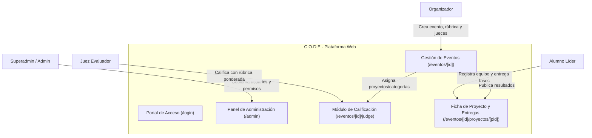

---

## 1. Portal de Acceso y Autenticación

El acceso al sistema se realiza a través de la ruta `/login`. La autenticación está construida sobre Firebase Auth con soporte para correo institucional y contraseña, así como restablecimiento automático de clave y selector de tema claro/oscuro.

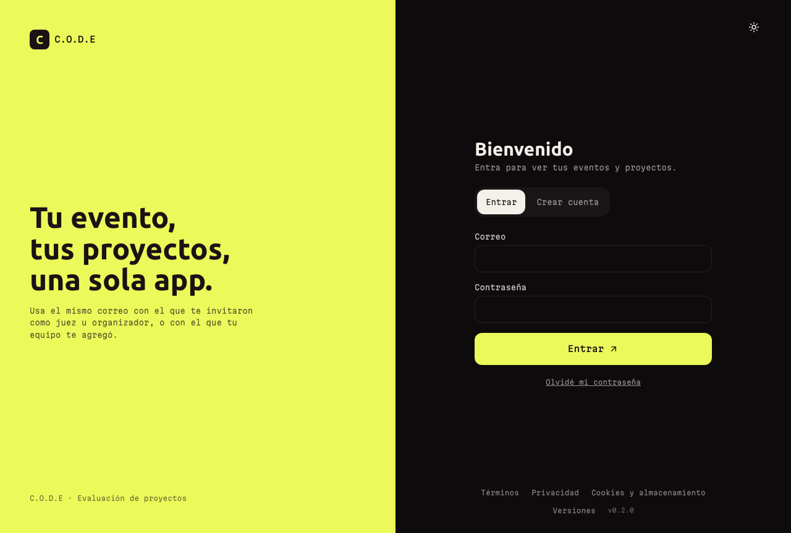

> **Nota:** Las sesiones se autentican contra el proyecto Firebase `code-94fbe`. Al iniciar sesión con un correo asignado a cualquiera de los roles, la aplicación enruta automáticamente al usuario al panel principal (`/panel`).

---

## 2. Rol: Administrador (Superadmin / Admin)

El Administrador tiene el control global de la plataforma para auditar eventos de todas las academias, supervisar el padrón de usuarios y regular permisos o suspensiones de cuenta.

### 2.1 Dashboard de Administración
Al ingresar, el Administrador visualiza en su panel los accesos de nivel ejecutivo: acceso directo a la consola de **Administración** (`/admin`), botón de **Crear evento**, buscador de eventos por código y la lista de eventos en los que participa directamente.

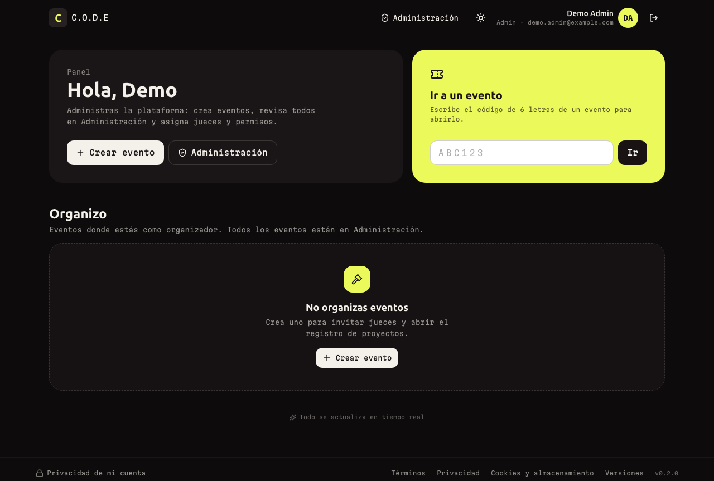

### 2.2 Padrón Global de Usuarios (Pestaña "Usuarios")
En esta vista se consolida a cada usuario registrado en Firebase Auth, cruzando su identidad con sus asignaciones en Firestore. Permite:
- **Filtrar por estatus**: Todos, Admins, Organizadores, Jueces, Suspendidos o Pendientes.
- **Auditoría rápida**: Ver en cuántos eventos funge como juez, cuántos organiza y cuántos proyectos tiene vinculados.
- **Acceso a perfil detallado**: Modificar roles de plataforma o suspender cuentas maliciosas.

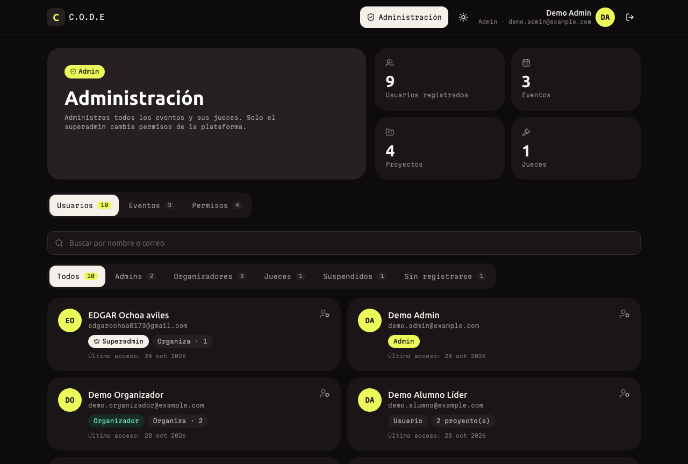

### 2.3 Inventario y Gobernanza de Eventos (Pestaña "Eventos")
Permite supervisar todos los eventos de la institución creados en la plataforma:
- Consultar código de evento de 6 caracteres (ej. `DEMO26`).
- Identificar al propietario y estado de apertura de inscripciones y evaluación.
- Gestionar organizadores y jueces auxiliares o eliminar eventos en caso de requerirse.

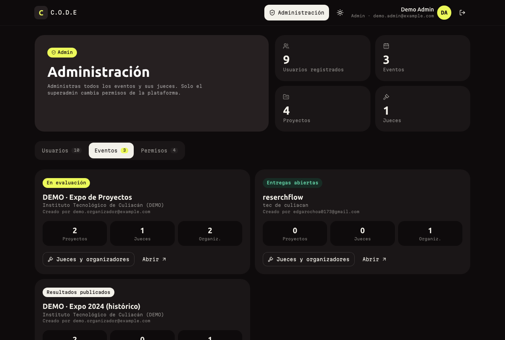

### 2.4 Control de Roles y Permisos (Pestaña "Permisos")
El Superadmin (`edgarochoa0173@gmail.com`) o un Admin autorizado puede otorgar los siguientes privilegios globales a cualquier correo:
- `admin`: Capacidad de administrar eventos, usuarios y jueces de toda la institución.
- `organizer`: Capacidad de crear y operar sus propios eventos escolares.
- `blocked`: Bloqueo inmediato de acceso para cuentas infractoras.

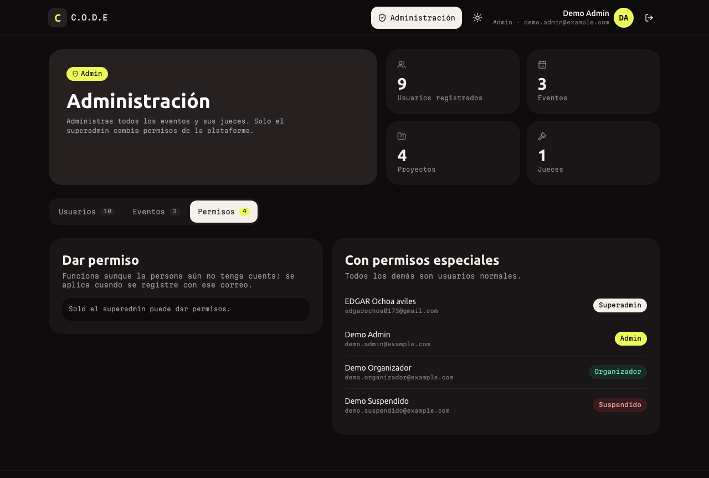

---

## 3. Rol: Organizador

El Organizador es el docente o coordinador responsable de dar de alta el evento, estructurar las etapas, parametrizar la rúbrica de evaluación, asignar a los jueces y publicar el dictamen final.

### 3.1 Dashboard del Organizador
Muestra los eventos creados o coordinados en la sección **Organizo**, junto con métricas de avance y accesos rápidos a la creación de nuevas convocatorias.

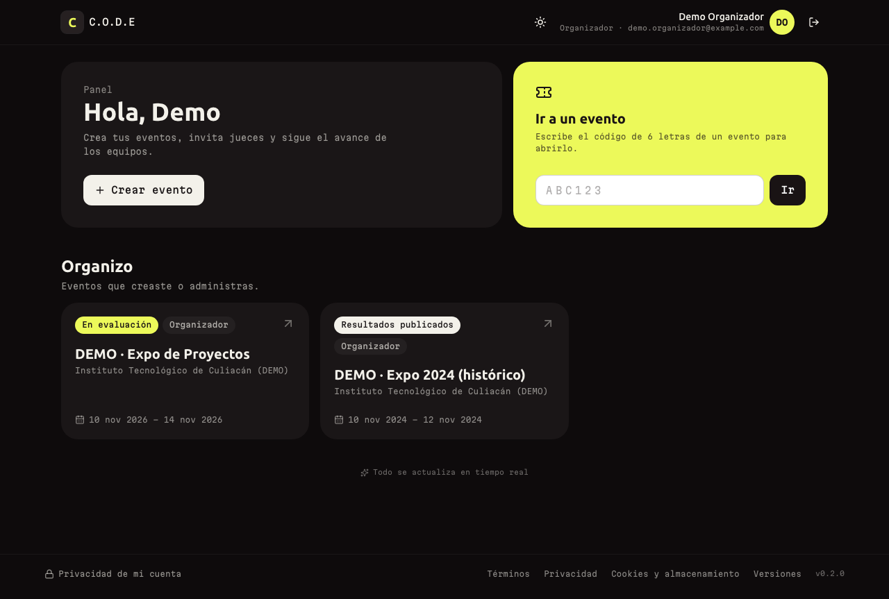

### 3.2 Formulario de Alta de Evento (`/eventos/nuevo`)
Permite configurar las variables maestras del certamen:
- **Datos institucionales**: Nombre del evento e institución convocante.
- **Identificador**: Código único alfanumérico para inscripción de alumnos (ej. `DEMO26`).
- **Fases del concurso**: Prototipo y/o Producto Final.
- **Límites de equipo**: Tamaño máximo de integrantes (ej. 5 alumnos).
- **Vigencia**: Fechas de inicio y cierre.

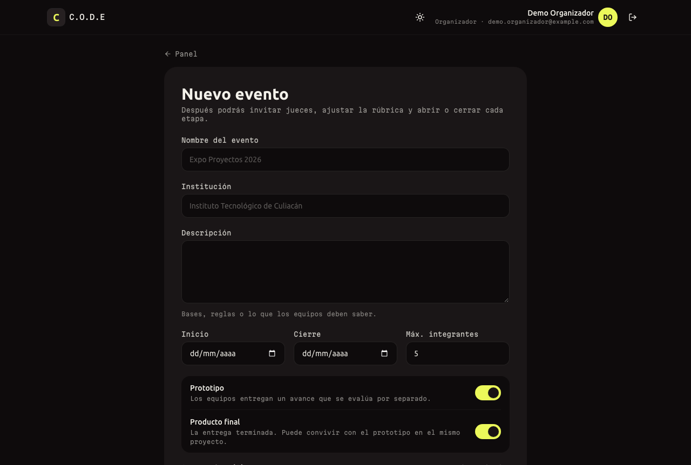

### 3.3 Centro de Control del Evento (Pestaña "Resumen")
Panel en vivo que resume las métricas operativas del evento:
- Estatus de las 4 etapas: Registro de proyectos, Entrega de prototipo, Entrega de producto final y Resultados.
- Conteo de proyectos registrados, jueces activos y evaluaciones emitidas.
- Botones de acción para compartir enlace o código de registro.

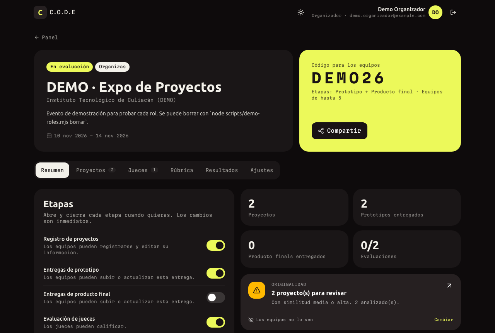

### 3.4 Padrón de Proyectos y Detección de Similitud (Pestaña "Proyectos")
Muestra la lista de proyectos registrados por los equipos:
- **Categoría**: Hardware/IoT, Software, Innovación Social, etc.
- **Entregas**: Indicadores de entregas de prototipo y producto final completadas.
- **Similitud y Originalidad**: Indicador porcentual de coincidencias detectadas mediante MinHash contra el histórico de proyectos de años previos.

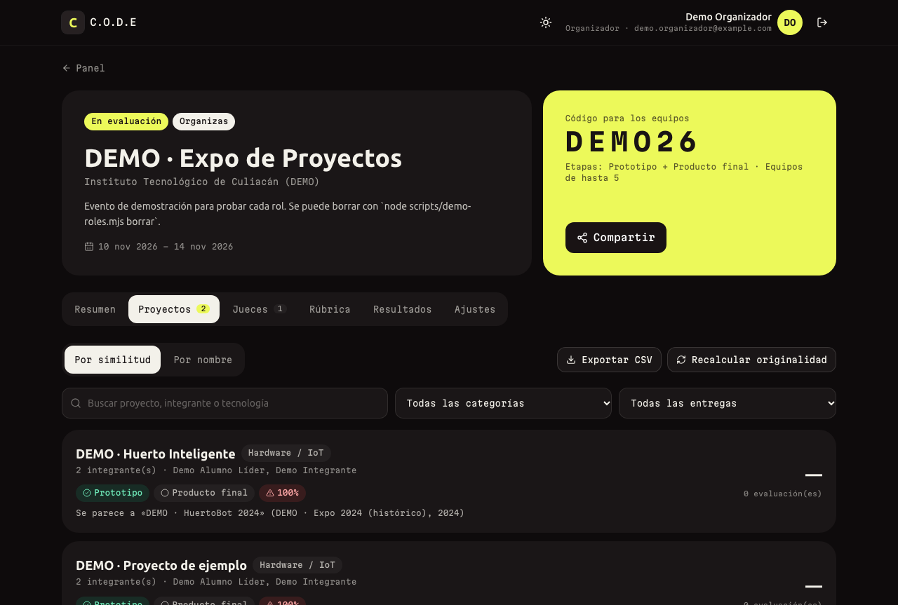

### 3.5 Asignación y Avance de Jueces (Pestaña "Jueces")
Control del cuerpo colegiado de evaluación:
- Invitación de jueces mediante lista de correos.
- **Asignación personalizada**: Posibilidad de asignar jueces a categorías específicas o a proyectos puntuales.
- **Barra de progreso individual**: Monitoreo de qué porcentaje de proyectos asignados ha calificado cada juez.

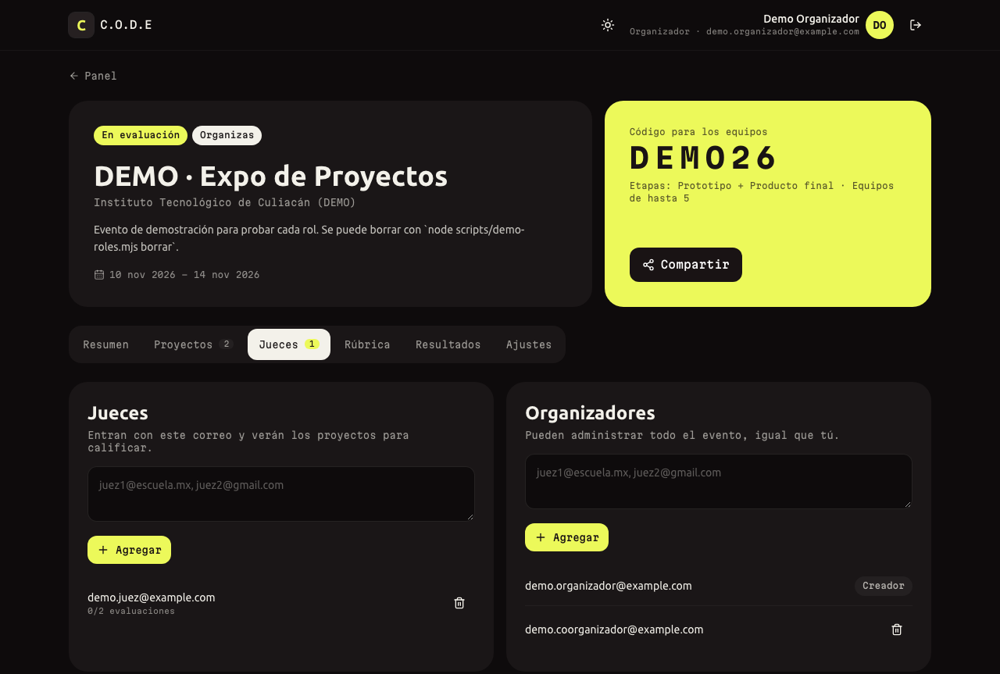

### 3.6 Parametrización de Rúbrica (Pestaña "Rúbrica")
Permite definir los criterios con los que evaluarán los jueces:
- **Criterios ponderados**: Porcentaje o peso de cada aspecto (Innovación 25%, Viabilidad Técnica 25%, Impacto 20%, Funcionalidad 15%, Presentación 15%).
- **Normalización automática**: El sistema normaliza los pesos al 100% de forma transparente.
- **Descripciones guía**: Guía cualitativa para estandarizar el criterio de los jueces.

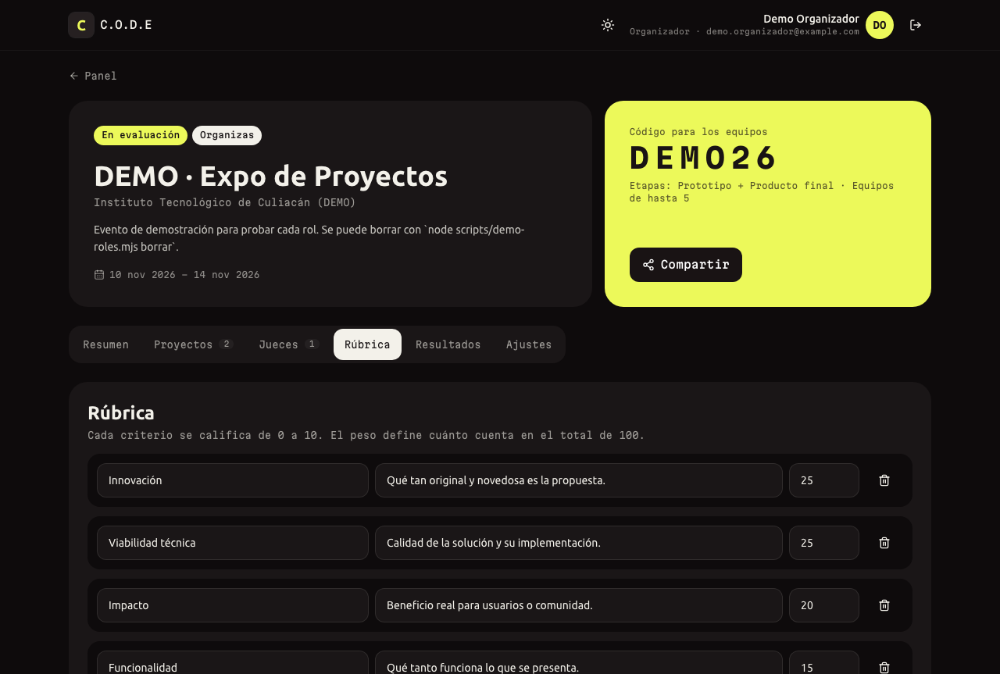

### 3.7 Resultados y Publicación (Pestaña "Resultados")
Tablero de cálculo de posiciones finales:
- Promedios ponderados por proyecto y fase.
- Filtro por categoría o tabla general.
- **Botón "Publicar resultados"**: Abre la visibilidad de los resultados y retroalimentación para los alumnos participantes.
- **Botón "Exportar CSV"**: Descarga una hoja de cálculo con el desglose de puntajes para actas académicas.

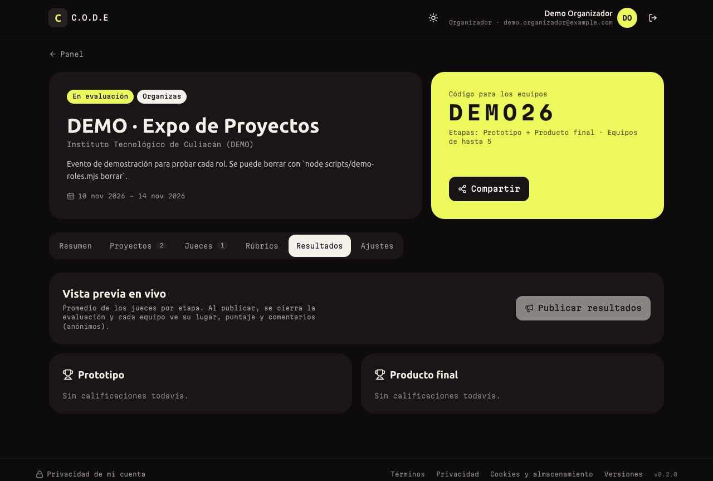

### 3.8 Ajustes Operativos (Pestaña "Ajustes")
Permite al organizador abrir o cerrar dinámicamente las compuertas del evento:
- **Registro de proyectos abierto/cerrado**.
- **Recepción de entregas** (por fase: prototipo / final).
- **Evaluación de jueces abierta/cerrada**.
- **Política de originalidad**: Configura si los jueces y alumnos pueden ver los porcentajes de similitud.

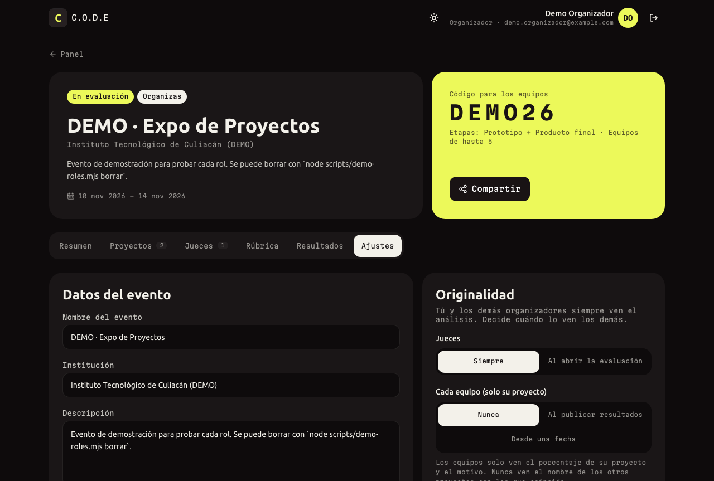

---

## 4. Rol: Juez

El Juez es el evaluador técnico responsable de examinar las evidencias entregadas por los alumnos y emitir calificaciones numéricas junto con observaciones constructivas.

### 4.1 Dashboard del Juez
Al iniciar sesión, el juez observa directamente en la parte superior la sección **Para evaluar**, con tarjetas oscuras que destacan los eventos donde fue designado.

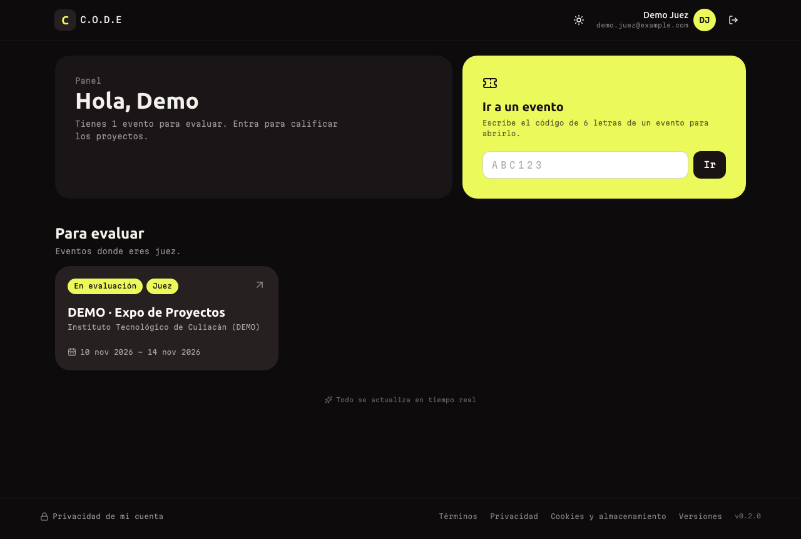

### 4.2 Lista de Proyectos y Progreso de Calificación
Al ingresar al evento, el juez cuenta con:
- **Medidor de avance propio**: Muestra cuántas evaluaciones ha completado del total asignado (ej. `1/2 · 50%`).
- **Filtros por pestaña**: `Pendientes`, `Asignados` y `Todos`.
- **Buscador interactivo**: Localiza rápidamente proyectos por nombre o tecnología.

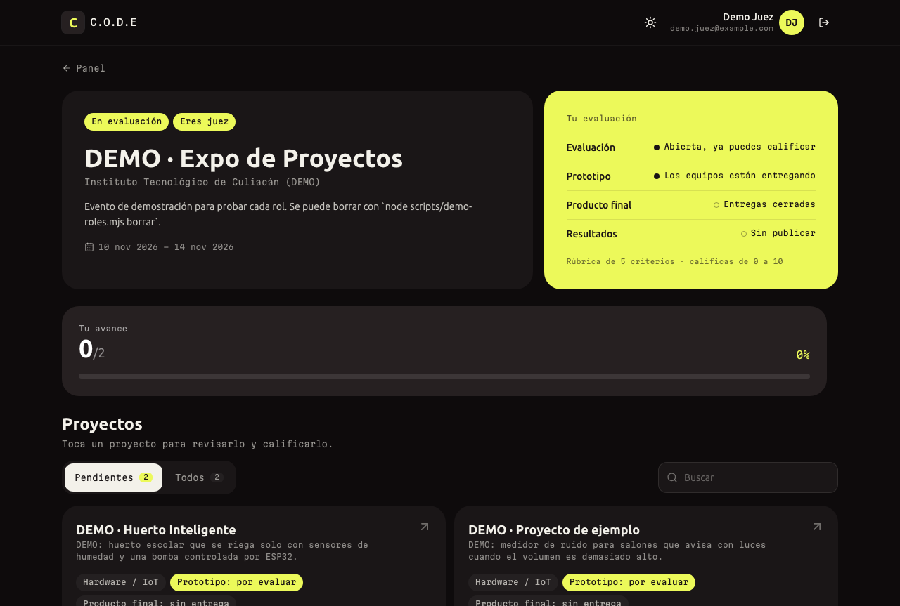

### 4.3 Hoja de Evaluación Multicriterio (Pestaña "Evaluar")
Al abrir un proyecto, el juez examina las pestañas de **Información**, **Prototipo** y **Producto final** (revisando repositorios, videos demo y documentos). En la pestaña **Evaluar**:
- Ajusta sliders interactivos del 0 al 10 en cada criterio de la rúbrica oficial.
- El sistema calcula el puntaje ponderado automáticamente en tiempo real.
- Redacta comentarios y retroalimentación para retroalimentar al equipo estudiantil.

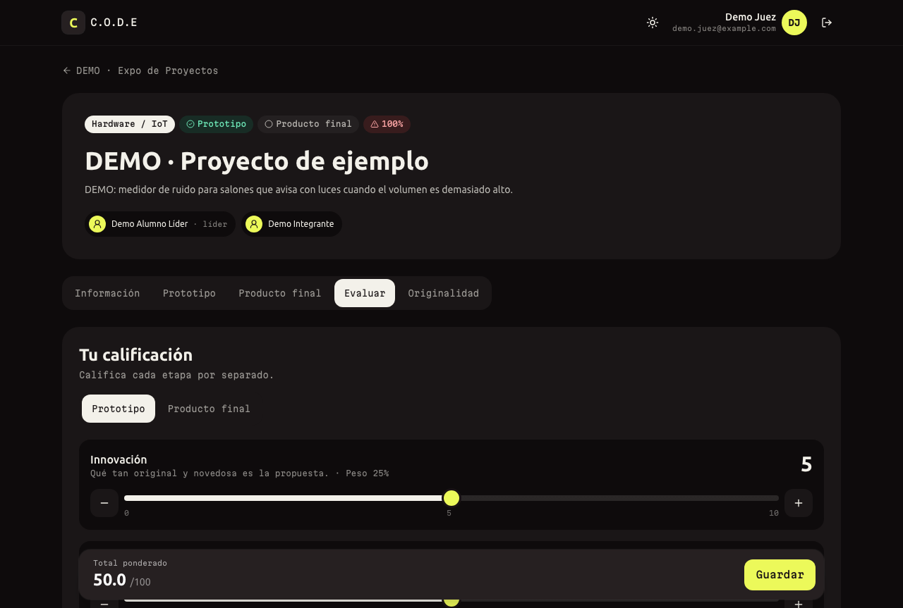

---

## 5. Rol: Alumno Líder

El Alumno Líder es el estudiante responsable de registrar al equipo, ingresar el código del evento, subir los entregables y consultar la retroalimentación emitida por los jueces.

### 5.1 Dashboard del Alumno
El estudiante cuenta con:
- La tarjeta **"¿Tienes un código?"**: Permite ingresar el código de 6 letras que le proporcionó su organizador docente para inscribir su proyecto.
- La sección **"Mis proyectos"**: Acceso directo a los proyectos donde es integrante o líder, mostrando las insignias de entregas realizadas.

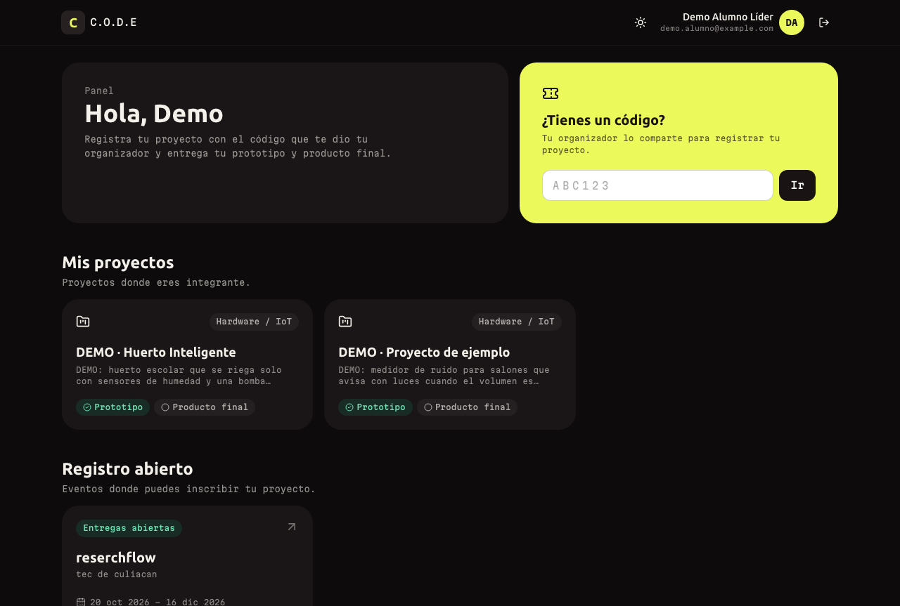

### 5.2 Registro del Proyecto Escolares
Cuando el alumno ingresa al evento por primera vez (o un alumno nuevo entra al evento con registro abierto):
- Captura el **Título del proyecto** y **Resumen ejecutivo**.
- Planteamiento del **Problema** que resuelve y la **Solución** desarrollada.
- Selección de **Categoría** y **Tecnologías utilizadas** (tags dinámicos).
- **Integrantes**: Añade a sus compañeros de equipo con nombre y correo electrónico (respetando el límite de tamaño de equipo del evento).

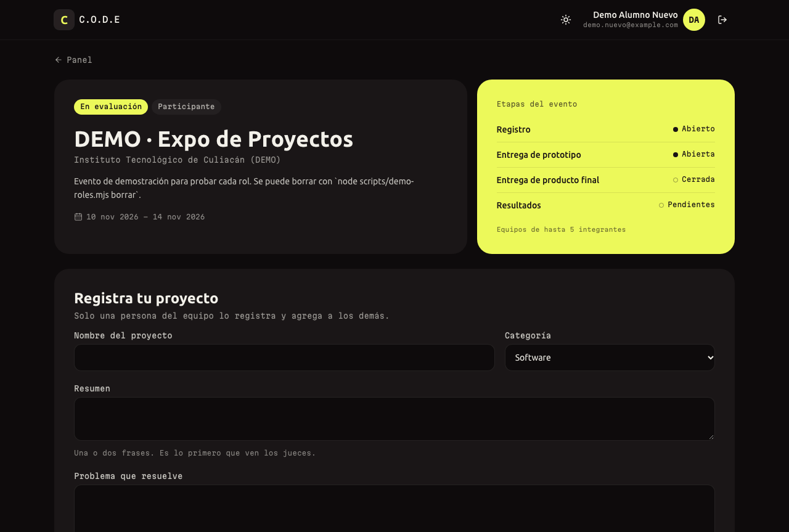

### 5.3 Ficha Técnica del Proyecto (Pestaña "Información")
Presenta la vista integral del proyecto:
- Título, categoría e integrantes con la insignia distintiva de **Líder**.
- Badges de estatus de entregas para saber si la fase de prototipo o final ha sido enviada.
- Opciones de edición de información para el líder del equipo mientras el registro esté abierto.

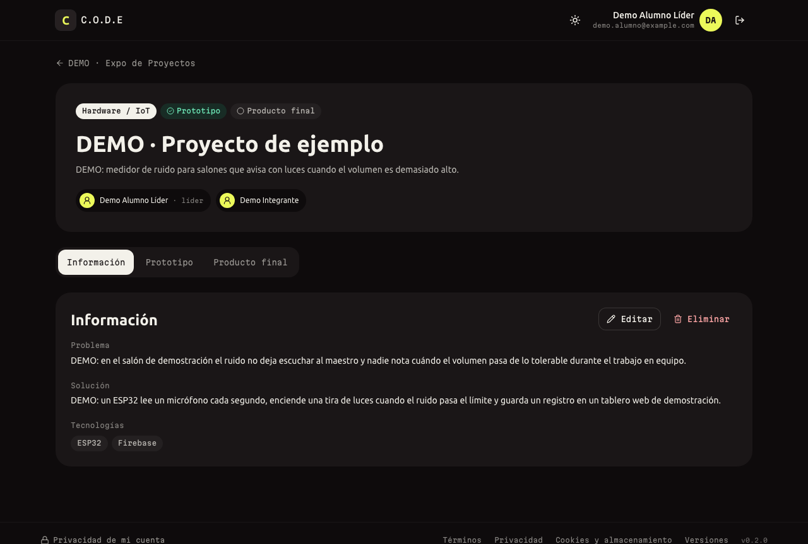

### 5.4 Entrega de Fases (Prototipo y Producto Final)
En las pestañas de **Prototipo** y **Producto final**, el líder sube las evidencias de su trabajo:
- **Descripción**: Resumen de los entregables y alcance funcional logrado.
- **Enlaces externos**: Repositorios de código fuente (GitHub/GitLab), diseños en Figma o enlaces a demos en video.
- **Archivos adjuntos con Hash SHA-256**: Los archivos cargados calculan criptográficamente su huella digital SHA-256 en el cliente para garantizar la autenticidad e inmutabilidad de la entrega académica.

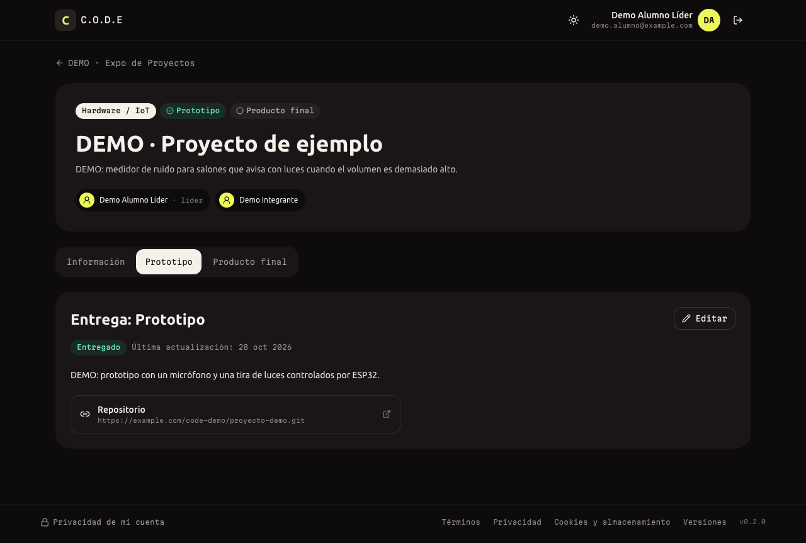

---

## 6. Matriz Comparativa de Capacidades por Rol

| Módulo / Acción | Admin | Organizador | Juez | Alumno Líder |
| :--- | :---: | :---: | :---: | :---: |
| **Acceso a Panel Global (`/admin`)** | **Sí** | No | No | No |
| **Suspender o autorizar cuentas** | **Sí** | No | No | No |
| **Crear nuevos eventos** | **Sí** | **Sí** | No | No |
| **Editar rúbrica del evento** | **Sí** | **Sí** | No | No |
| **Asignar jueces a proyectos/categorías** | **Sí** | **Sí** | No | No |
| **Abrir/cerrar entregas y evaluaciones** | **Sí** | **Sí** | No | No |
| **Publicar resultados oficiales** | **Sí** | **Sí** | No | No |
| **Calificar proyectos asignados** | No* | No* | **Sí** | No |
| **Registrar proyecto y agregar equipo** | No | No | No | **Sí** |
| **Subir prototipo y producto final** | No | No | No | **Sí** |
| **Ver retroalimentación y dictamen** | **Sí** | **Sí** | **Sí** | **Sí** (Al publicar) |

*\* Los administradores y organizadores pueden autoasignarse como jueces si desean evaluar.*

---

## 7. Verificación de Seguridad y Reglas de Firestore

Toda la seguridad y el aislamiento de datos entre escuelas y eventos está blindado mediante las reglas declarativas de Firestore en `firestore.rules`. Los alumnos solo pueden editar sus propios proyectos mientras las fechas estén vigentes; los jueces solo pueden escribir sus propias evaluaciones; y los organizadores gobiernan únicamente los eventos bajo su propiedad o delegación.
